# Lumen: MERN E‑commerce Store

A full-stack online store built with **MongoDB, Express, React and Node.js**. The storefront is clean and Apple-inspired: big type, lots of white space, smooth scroll animations and a frosted-glass navigation bar. An **admin dashboard** lets you change every product, banner and piece of store text without touching code, and checkout supports **Razorpay** online payments and Cash on Delivery.

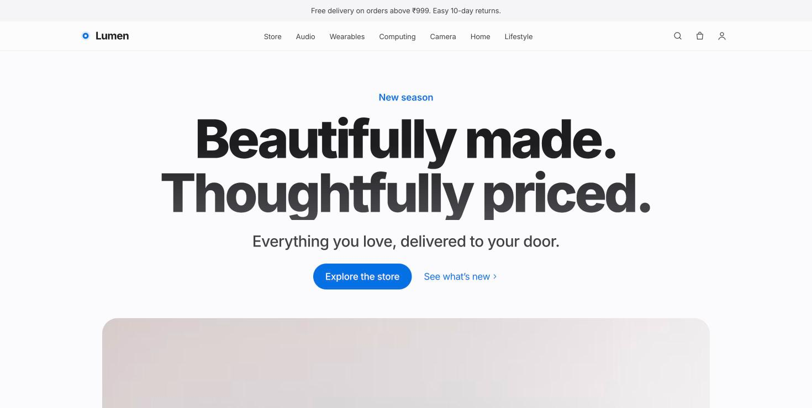

## Screenshots

### Storefront

| Showcase banners | "The latest" shelf |
|---|---|
| 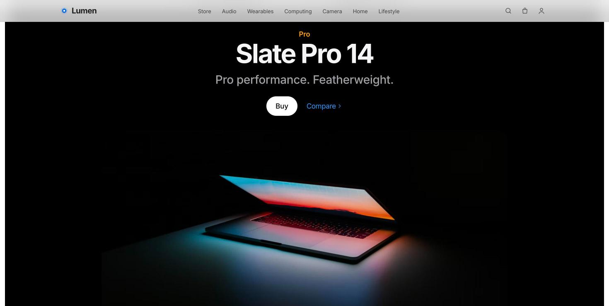 | 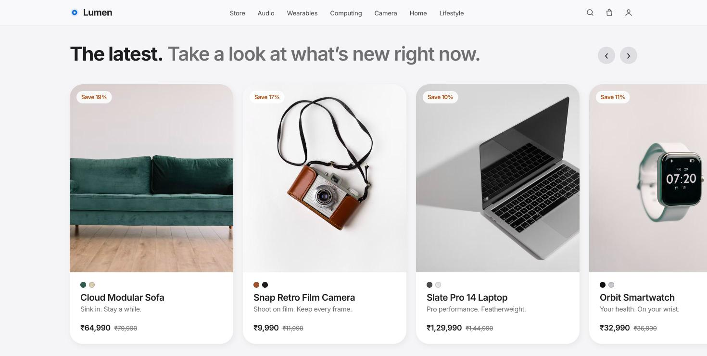 |

| Store with filters | Product page |
|---|---|
| 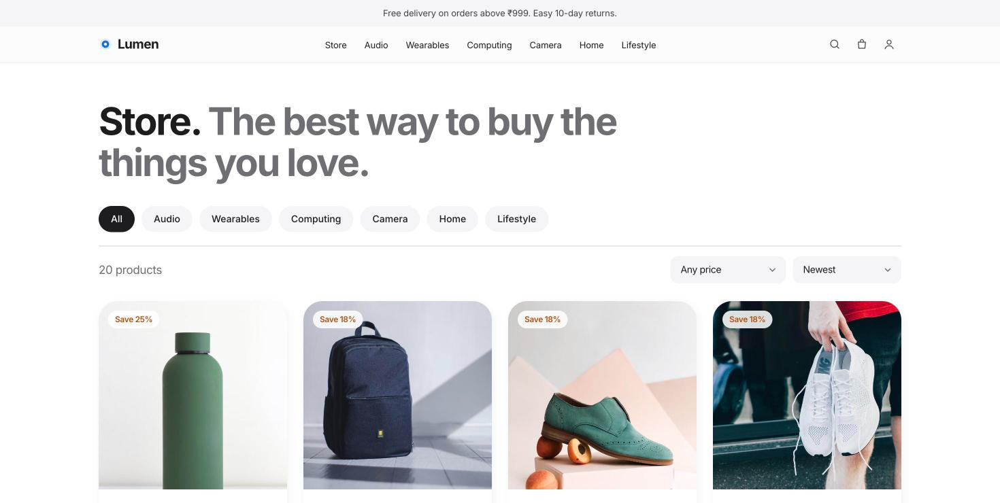 | 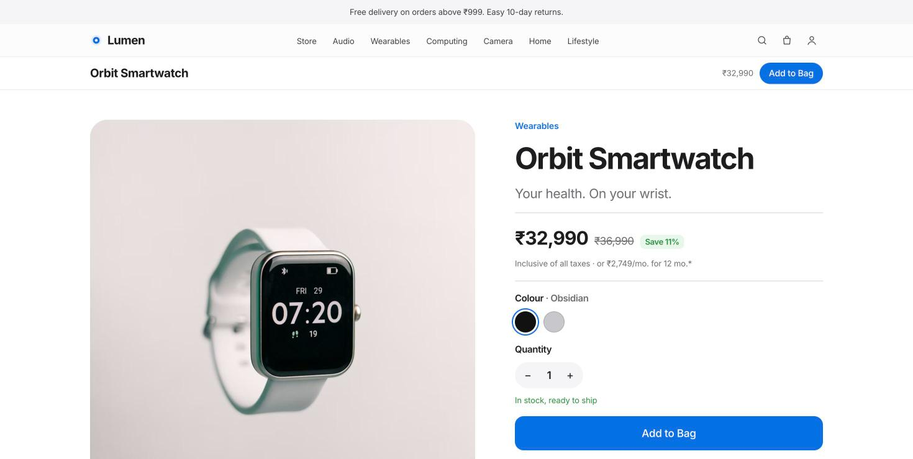 |

### Admin dashboard

The dashboard lives at `/admin` and you sign in with an admin account. Every change you make there is saved to MongoDB and shows up in the store straight away.

**Overview:** revenue, orders, customers, product count, a 14-day sales chart, top sellers, recent orders and low-stock alerts.
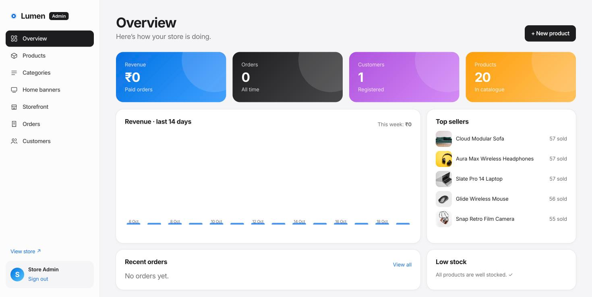

| Products: search, featured/visible switches, edit, delete | Product editor: details, pricing, stock, images, colours, live preview |
|---|---|
| 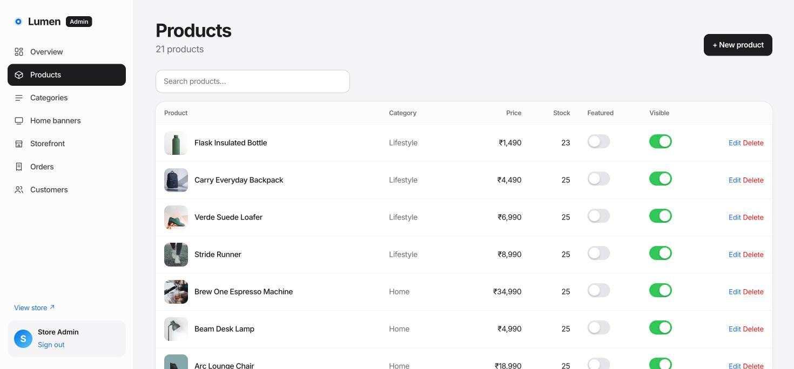 | 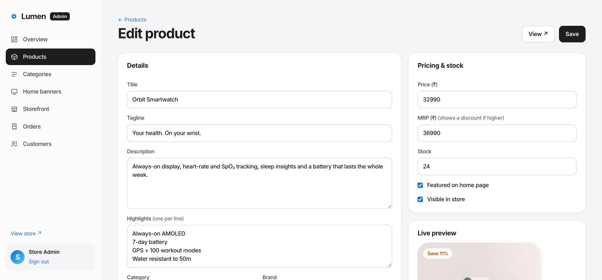 |

| Home banners: add, reorder, show/hide, live preview | Storefront: store name, colour, announcement, hero, delivery and GST |
|---|---|
| 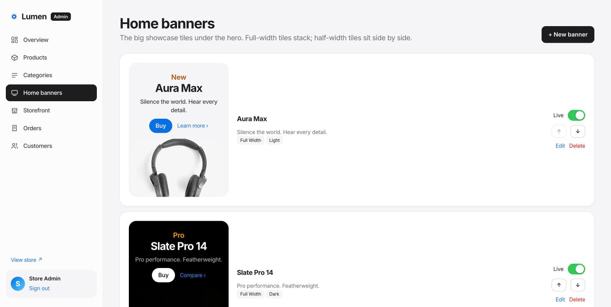 | 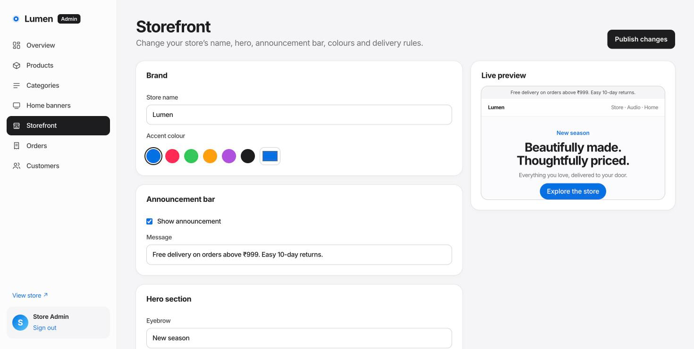 |

| Orders: filter by status, view details, change status | Categories | Customers: give or remove admin access |
|---|---|---|
| 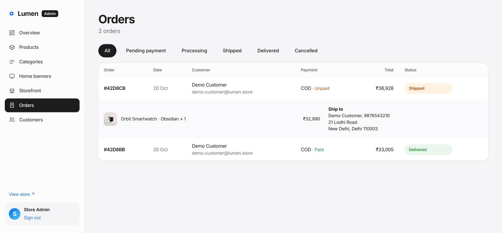 | 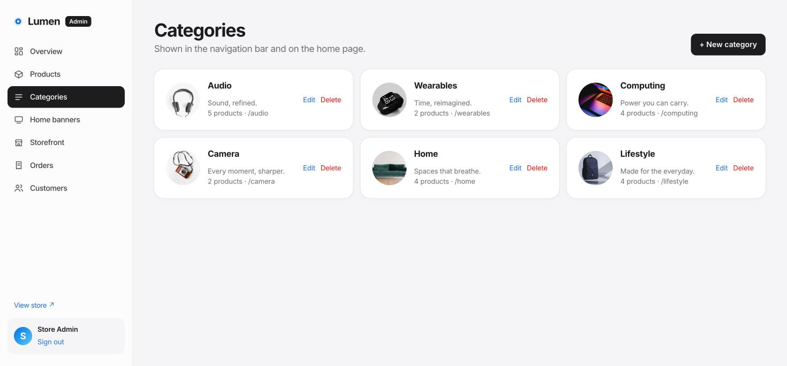 | 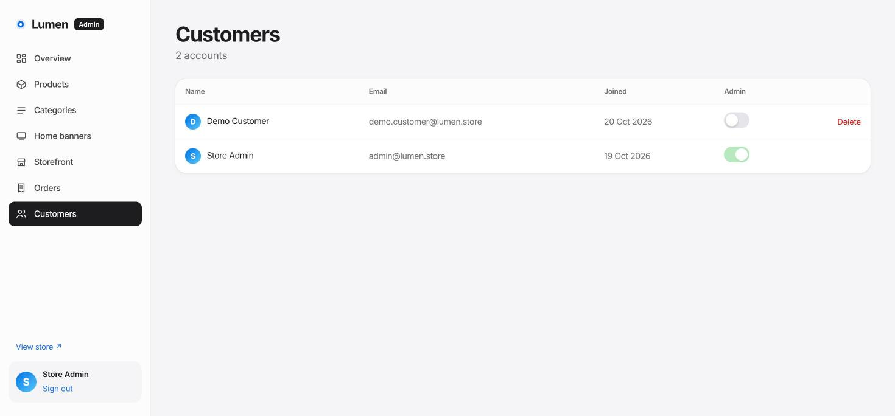 |

> 📘 **New here?** Read the full **[Step-by-step guide](docs/GUIDE.md)**: MongoDB Atlas setup, using the admin dashboard, and working on the frontend and backend.

## Features

### Storefront
- A home page with a big hero section, full-width and half-width showcase banners, a sideways-scrolling "The latest" shelf, category circles and a best-sellers grid
- Live search: results appear as you type
- Shop page with category chips, price ranges, five sort orders and page numbers
- Product pages with an image gallery, colour and quantity pickers, stock levels, highlights, related products and customer reviews
- A slide-out bag with a free-delivery progress bar, plus a full bag page
- Checkout with address checks (10-digit phone, 6-digit PIN code), Razorpay payment (UPI, cards, netbanking, wallets) or Cash on Delivery
- Order history and tracking (Processing → Shipped → Delivered) and order cancellation
- Customer accounts: sign up, sign in, saved address, change name or password
- Works on phones, and turns off animations for people who have reduced motion switched on

### Admin dashboard (`/admin`)
- **Overview:** revenue, orders, customers, a 14-day revenue chart, top sellers, low-stock alerts and recent orders
- **Products:** add, edit and delete products, upload images or paste image URLs, set colours and highlights, preview the product card live, and switch "featured" and "visible" on or off
- **Categories:** add, edit and delete categories (a category that still has products can't be deleted)
- **Home banners:** add, edit, reorder, hide and delete banners with a live preview, and choose light or dark, full or half width
- **Storefront:** store name, accent colour, announcement bar, hero headline, image and button, free-delivery limit, delivery fee and GST rate. Changes go live straight away.
- **Orders:** filter by status, view an order's details and change its status. Cash on Delivery orders are marked paid once delivered.
- **Customers:** make someone an admin or remove admin access, and delete accounts

### Backend
- Sign-in with JWT tokens and bcrypt password hashing, plus limits on repeated login attempts
- **Prices are always worked out on the server from the database.** The prices the browser sends are never used.
- Stock is checked before ordering, reduced on purchase and restored on cancellation
- **Razorpay:** the server creates the payment order, then checks Razorpay's signature on the result, so a faked payment is rejected
- Image uploads (up to 5 MB, image files only), stored in `server/uploads`
- Security headers (Helmet), CORS and clear error messages

## Tech stack

| Layer | Tech |
|---|---|
| Frontend | React 18, React Router 6, Vite, hand-written CSS (no UI library) |
| Backend | Node.js, Express 4, Mongoose 8 |
| Database | MongoDB Atlas |
| Payments | Razorpay (test mode) |
| Auth | JWT + bcrypt |

## Getting started

These are the quick steps. For screen-by-screen MongoDB Atlas instructions, see the **[guide](docs/GUIDE.md#1-set-up-mongodb-atlas)**.

### 1. Requirements
- Node.js 18 or newer: [nodejs.org](https://nodejs.org)
- A MongoDB Atlas cluster (the free M0 tier is enough)
- Optional: Razorpay **test** API keys from [dashboard.razorpay.com](https://dashboard.razorpay.com) → Settings → API Keys

### 2. Install
```bash
git clone https://github.com/neerajR596/lumen-store.git
cd lumen-store
npm run install-all
```

### 3. Configure
```bash
cp server/.env.example server/.env
```
Edit `server/.env`:

| Variable | What it is |
|---|---|
| `MONGO_URI` | Your Atlas connection string (Atlas → Connect → Drivers). Replace `<db_password>` with your password. |
| `JWT_SECRET` | Any long random string |
| `ADMIN_EMAIL` / `ADMIN_PASSWORD` | The admin account the seed script creates |
| `RAZORPAY_KEY_ID` / `RAZORPAY_KEY_SECRET` | Razorpay test keys. Leave them out to offer Cash on Delivery only. |

In Atlas, open **Network Access** and allow your IP address.

### 4. Load sample data
```bash
npm run seed            # 6 categories, 20 products, 4 banners, store settings and the admin account
npm run seed -- --fresh # wipe and reload products, categories, banners and settings
```

### 5. Run

**Development** (with live reload):
```bash
npm run dev
```
- Store: http://localhost:5173
- API: http://localhost:5050/api

**Production-style** (one server):
```bash
npm run build && npm start
```
- Store and API: http://localhost:5050

**macOS shortcut:** double-click `start-lumen.command`. It installs everything, loads the sample data on first run, builds the store and opens it.

Admin dashboard: http://localhost:5050/admin. Sign in with `ADMIN_EMAIL` / `ADMIN_PASSWORD` (default `admin@lumen.store` / `admin12345`; change these before deploying).

### Testing payments
With test keys set, choose **Pay online** at checkout and use Razorpay's test details: UPI `success@razorpay`, or card `4111 1111 1111 1111` with any future expiry and any CVV.

## API reference

Base URL: `http://localhost:5050/api`. Routes marked 🔒 need an `Authorization: Bearer <token>` header; 👑 means admin only.

| Method | Endpoint | Description |
|---|---|---|
| GET | `/health` | Server and database status |
| POST | `/auth/register` | Create an account and get a token |
| POST | `/auth/login` | Sign in and get a token |
| GET / PUT | `/auth/me` 🔒 | View or update your profile, address and password |
| GET | `/products?q=&category=&min=&max=&sort=&page=&limit=&featured=` | List and search products |
| GET | `/products/:slugOrId` | One product plus related products |
| POST | `/products/:id/reviews` 🔒 | Add or update your review |
| POST / PUT / DELETE | `/products[/:id]` 👑 | Create, update or delete a product |
| GET | `/categories` | Categories with product counts |
| POST / PUT / DELETE | `/categories[/:id]` 👑 | Manage categories |
| GET | `/banners` (`?all=1` for admin) | Home page banners |
| POST / PUT / DELETE | `/banners[/:id]` 👑 | Manage banners |
| GET / PUT | `/settings` (PUT 👑) | Storefront settings |
| POST | `/orders/quote` | Price a bag (calculated on the server) |
| POST | `/orders` 🔒 | Place an order (`razorpay` or `cod`) |
| GET | `/orders/mine` 🔒 | Your orders |
| GET | `/orders/:id` 🔒 | Order details |
| PUT | `/orders/:id/cancel` 🔒 | Cancel your order |
| GET / PUT | `/orders`, `/orders/:id/status` 👑 | All orders, change status |
| GET | `/payments/config` | Whether Razorpay is enabled |
| POST | `/payments/razorpay/order` 🔒 | Create a Razorpay order |
| POST | `/payments/razorpay/verify` 🔒 | Check the payment signature and mark the order paid |
| GET | `/admin/stats` 👑 | Dashboard numbers |
| GET / PUT / DELETE | `/admin/users[/:id]` 👑 | Manage customers |
| POST | `/admin/upload` 👑 | Upload an image (`multipart/form-data`, field `image`) |

## Project structure
```
lumen-store/
├── client/                  # React + Vite storefront and admin
│   └── src/
│       ├── pages/           # Home, Shop, Product, Bag, Checkout, Orders, Auth, Account
│       ├── admin/           # Dashboard, Products, ProductEditor, Categories, Banners, Storefront, Orders, Users
│       ├── components/      # Nav, CartDrawer, ProductCard, Reveal (scroll animation), Footer, icons
│       ├── context/         # Auth, Cart, Store settings, Toasts
│       └── styles/          # global.css (storefront), admin.css
├── server/                  # Express API
│   └── src/
│       ├── models/          # User, Product, Category, Banner, Order, Settings
│       ├── routes/          # auth, products, categories, banners, settings, orders, payments, admin
│       ├── middleware/      # auth (JWT and admin check), error handling
│       └── data/seed.js     # sample data
├── docs/screenshots/
└── start-lumen.command      # macOS one-click start
```

## Deploying
- **Single service** (Render, Railway and similar): build command `npm run install-all && npm run build`, start command `npm start`, then add the variables from `.env.example`. Express serves the built React app and the API from the same URL.
- **Split hosting:** host `client/dist` on Vercel or Netlify with `VITE_API_URL=https://your-api-host`, and set `CLIENT_URL` on the server to your frontend's address.
- In Atlas → Network Access, allow your host's IP addresses (or `0.0.0.0/0`).
- Uploaded images are saved on the server's own disk. On hosts that wipe the disk on every redeploy, use image URLs or add a cloud storage service.

## Notes
Lumen is a demo / portfolio project. Product photos come from [Unsplash](https://unsplash.com), and the product names are made up.

---
Built by [@neerajR596](https://github.com/neerajR596)
